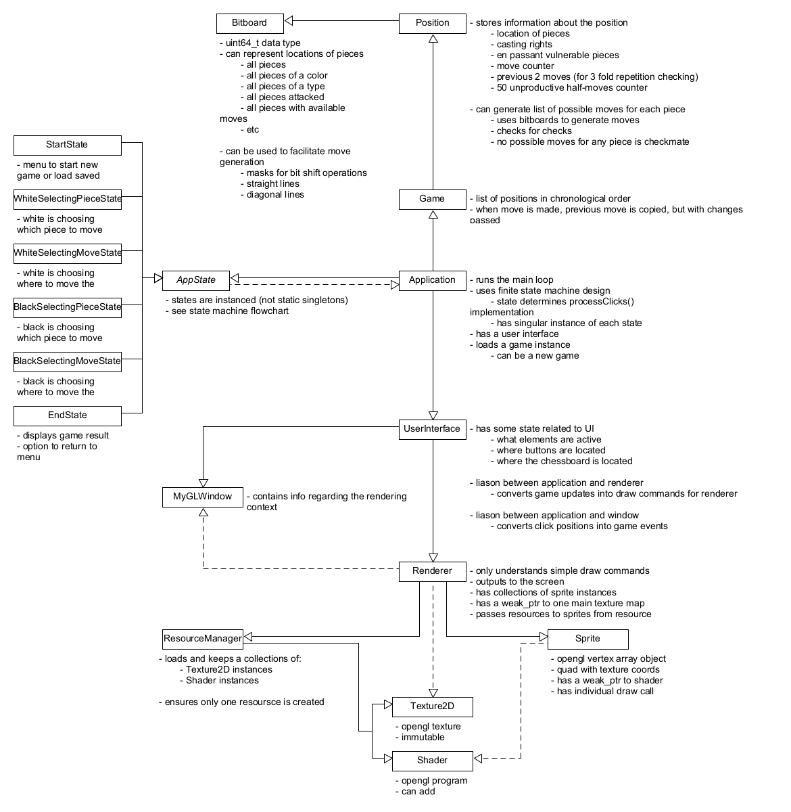
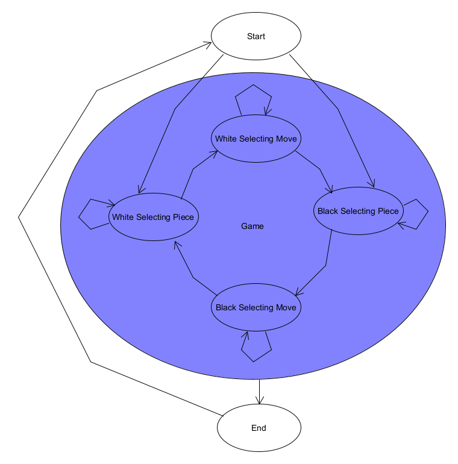

# BitChess


A 16-bit-style, local two-player chess game written in modern C++ and rendered
with OpenGL. Every rule of chess is implemented — from castling and en passant
to all five ways a game can draw. The project is a portfolio piece exploring
**game-engine architecture** and **2D graphics programming** from the ground up:
a hand-written sprite renderer, a bitboard move generator, and a state-machine
driven application loop, with no game framework underneath.

## Features

- **Complete chess rules** — legal move generation, check/checkmate/stalemate,
  castling, en passant, and pawn promotion.
- **Every draw type** — stalemate, threefold repetition, the fifty-move rule,
  and dead positions (insufficient material).
- **Bitboard engine** — positions and move generation are represented with
  64-bit bitboards.
- **Custom 2D renderer** — a small sprite/shader/texture layer built directly on
  OpenGL and GLFW, plus a resource manager and a finite-state-machine game loop.
- **Original pixel art** for the board, pieces, UI, and cursor.

## Getting Started

BitChess builds on **macOS** and **Linux** with CMake.

### Prerequisites

- A C++17 compiler (Clang or GCC)
- [CMake](https://cmake.org/) 3.16 or newer
- `git` (used only to auto-download GLFW when it isn't already installed)

GLFW is used from your system if it's installed; otherwise CMake fetches and
builds it automatically. To install it yourself (optional, for a faster first
build):

- **macOS:** `brew install glfw`
- **Debian/Ubuntu:** `sudo apt install libglfw3-dev`
- **Fedora:** `sudo dnf install glfw-devel`

> `glad`, `glm`, and `stb_image` are vendored in `lib/`, so there is nothing
> else to install.

### Build and run

Clone the repo, then either run the helper script:

```sh
./build.sh          # configure + build
./build.sh run      # configure + build, then launch
```

or use CMake directly:

```sh
cmake -B build
cmake --build build -j
./build/bit_chess
```

The game locates its assets relative to the executable, so `bit_chess` can be
launched from any working directory. To rebuild from scratch, delete the
`build/` directory.

## Controls

- **Mouse** — click a piece to select it, click a highlighted square to move.
- **Esc** — quit.

## Documentation

### Application Architecture


### State Machine Flowchart


See [Chess Programming Resources](doc/Resources.md) for background on the
bitboard techniques the engine is built on.

## Roadmap

Gameplay is feature-complete; these are polish and infrastructure items:

- Start menu (new game, load game, options, quit) and game-over screen
- Save / load games and PGN / FEN export
- Audio system and configurable color schemes
- Custom window decorations and resizing
- Native Windows build

## Changelog

### 0.6.0
- All draw types implemented — every rule of chess is now complete.

### 0.5.0
- Pawn promotion.
- Fixed a castling bug where the move-making function skipped castling rights.
- Fixed en passant bugs (passant table not resetting each move; moves generated
  in incorrect scenarios).

### 0.4.x
- Castling and en passant fully implemented.
- Legality checks for pseudo-legal en passant moves.

### 0.3.0
- King-in-check visualization.
- Checkmate pop-up with winner display.

### 0.2.x
- Piece movement and illegal-move filtering (check detection).
- Pawn double-move blocking and a king move-generation fix.

### 0.1.0
- Basic GUI, custom pixel art, and the start of the engine architecture.

## License

See [LICENSE](LICENSE).
